# 4 - Visualizing Finance Data: chart gallery

Every chart in this folder is produced by the notebooks next to this page and saved to `charts/`.
Open a notebook (e.g. [01_matplotlib_basics.ipynb](01_matplotlib_basics.ipynb)) to see each chart directly under the code that made it.

## 01 - Matplotlib basics (Line Graphs in Matplotlib)

The pattern every chart follows:

```python
plt.figure()                     # 1. new, empty chart
plt.plot(x, y)                   # 2. build it (nothing visible yet)
plt.savefig('charts/name.png')   # 3. save - BEFORE show
plt.show()                       # 4. display it
```

| | |
|---|---|
| **Basic line plot** - `plt.plot(days, money_spent)`<br>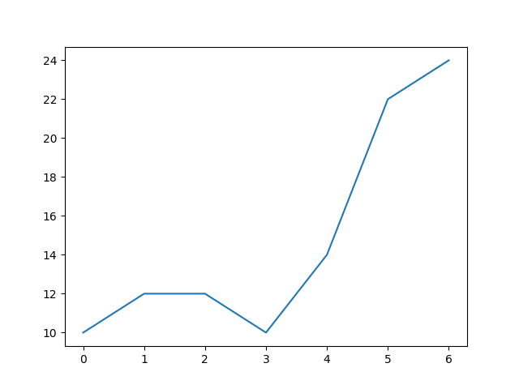 | **Multiple lines** - two `plot()` calls before one `show()`<br>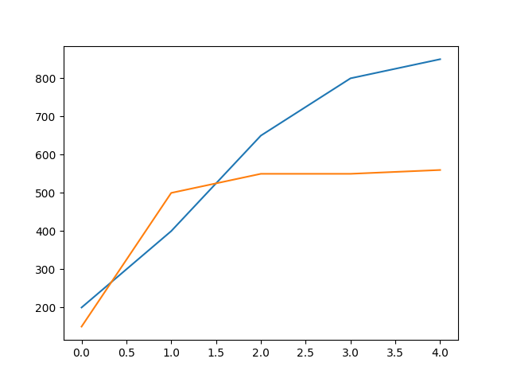 |
| **Linestyles** - `color=`, `linestyle='--'`, `marker='s'`<br>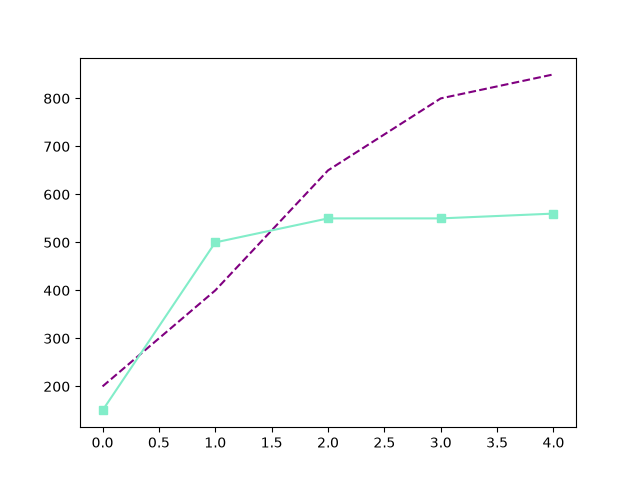 | **Mistake: x and y swapped** - "revenue vs time" is `plot(time, revenue)`<br>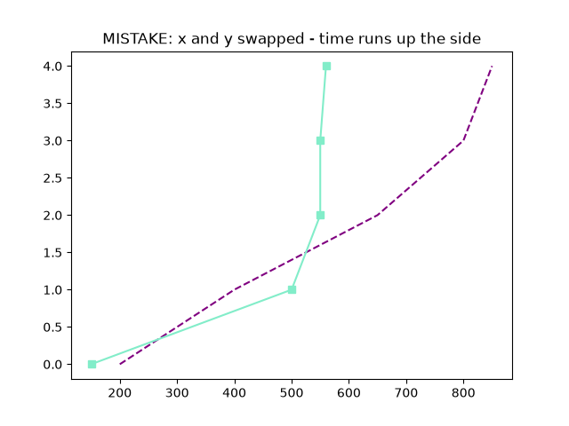 |
| **Zooming** - `plt.axis([0, 12, 2900, 3100])` (truncated y-axis exaggerates changes)<br>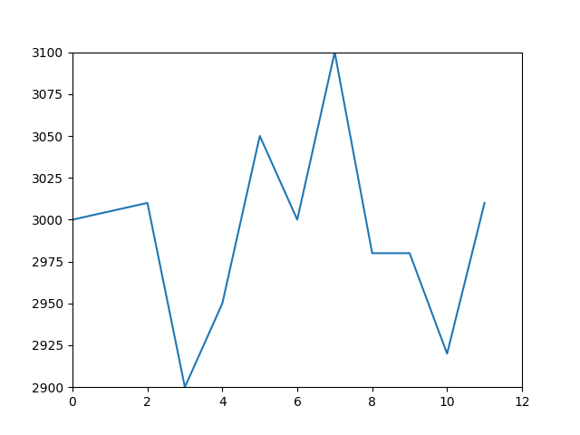 | **Labels and title** - `plt.xlabel / ylabel / title`<br>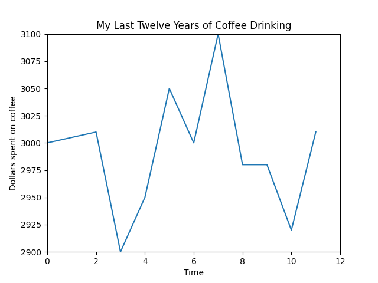 |
| **Subplots** - `plt.subplot(1, 2, 1)` and `(1, 2, 2)`; right box is a scatter (`'o'`)<br>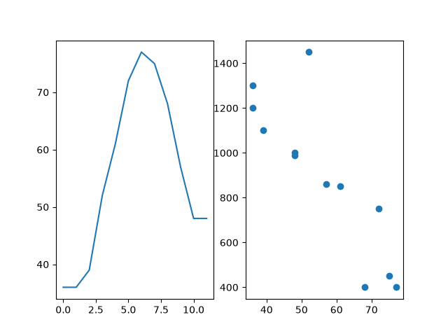 | **Mixed layout** - `(2, 1, 1)` on top, `(2, 2, 3)` and `(2, 2, 4)` below<br>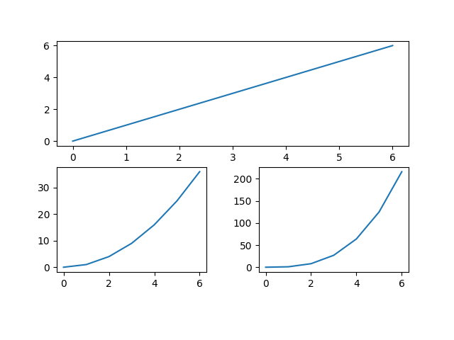 |
| **Legend** - `plt.legend(legend_labels, loc=8)`<br>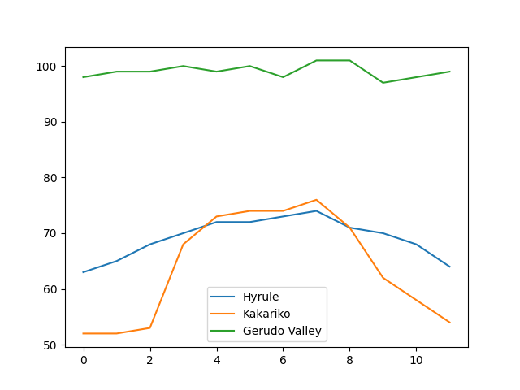 | **Mistake: list inside a list** - `[legend_labels]` gives one label<br>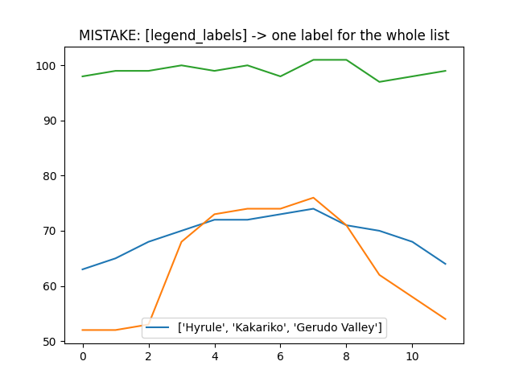 |
| **Custom ticks** - `ax.set_xticks` / `set_xticklabels`, hand-typed `'10%'` labels<br>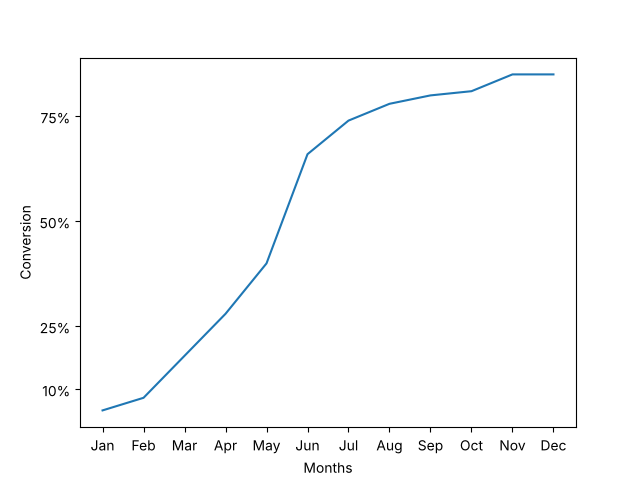 | **Faster way** - `PercentFormatter(1.0)` formats the whole axis<br>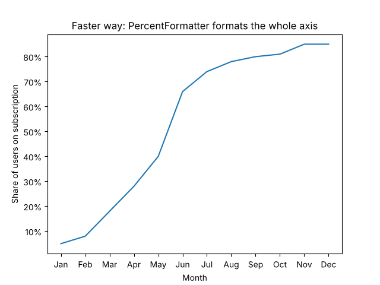 |
| **Figures** - default `plt.figure()`<br>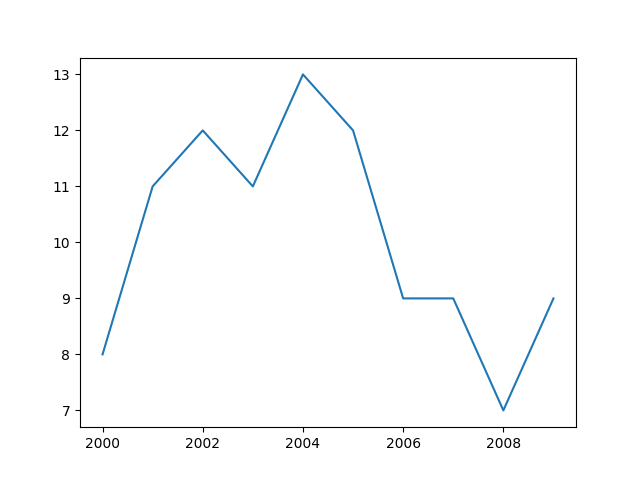 | **Figures** - `plt.figure(figsize=(7, 3))`, wide and flat<br>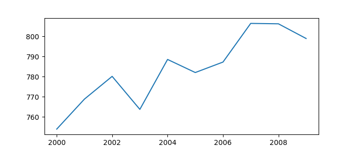 |
| **Mistake: no new figure** - both lines land on one sheet<br>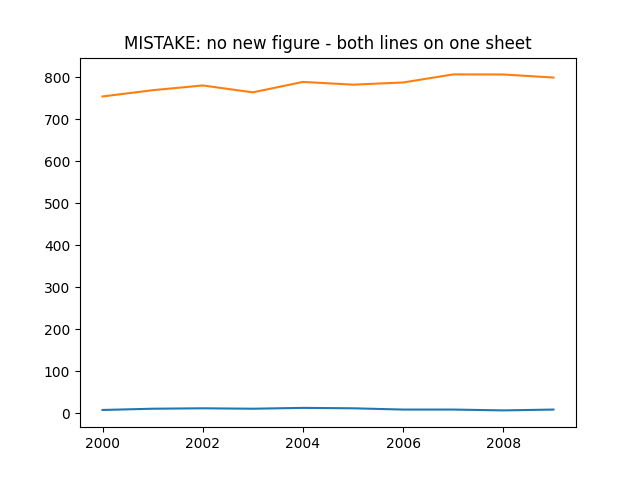 | **Review** - ECB deposit rate vs Austrian inflation, 2015-2025<br>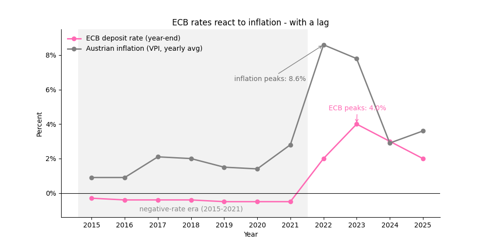 |

### Concept guides

**`plt.subplot(rows, cols, index)`** - blue = rows, orange = columns, green = which box

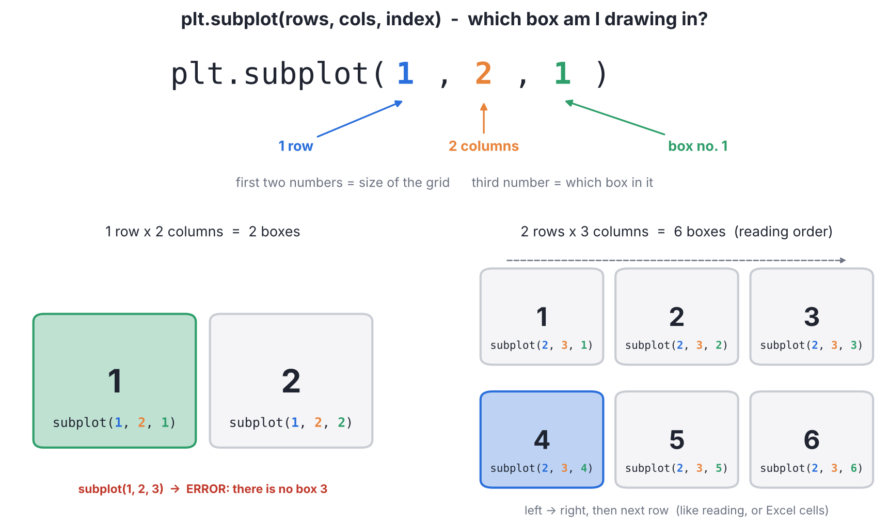

**Mixed layouts** - every box picks its own grid

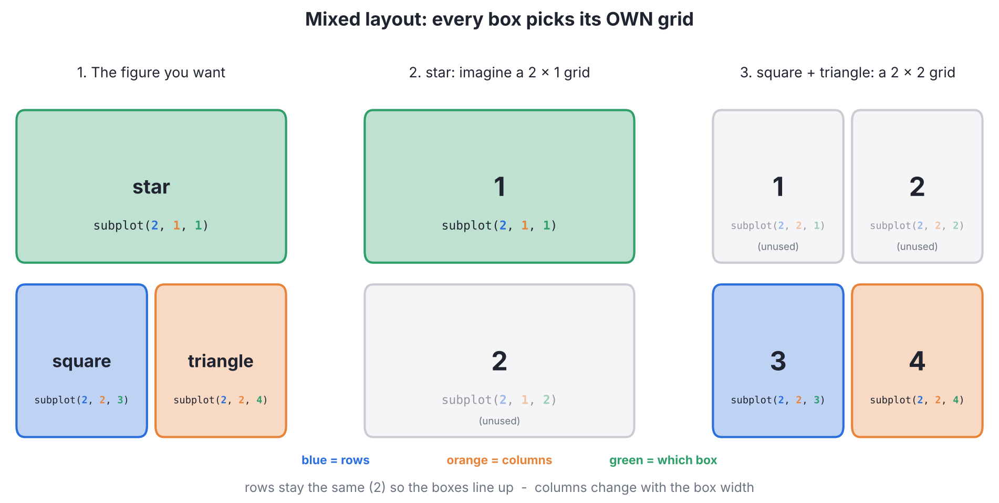

**`plt.subplots_adjust(...)`** - margins and gaps

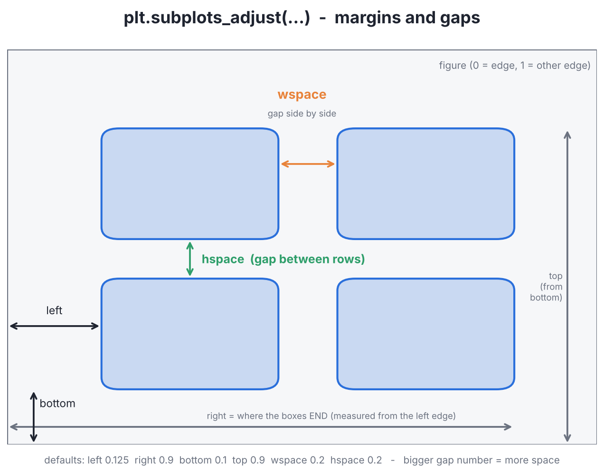
