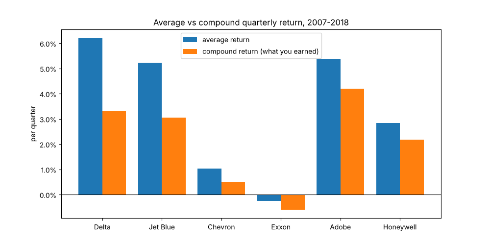
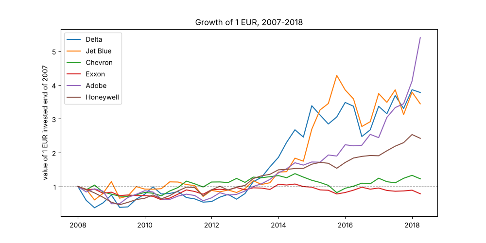
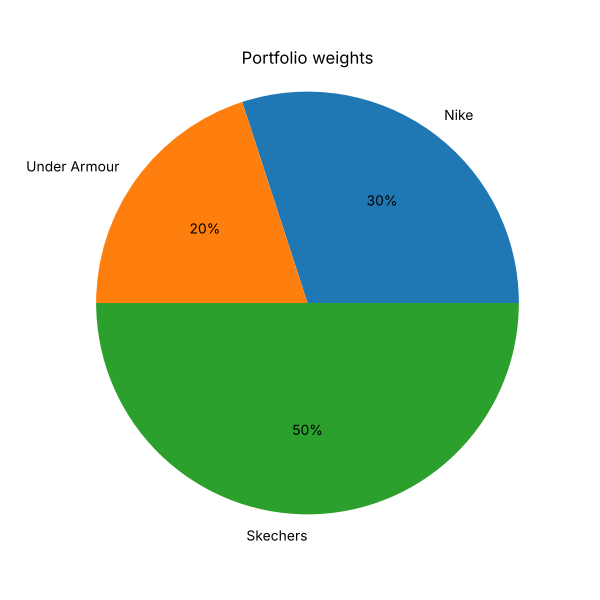
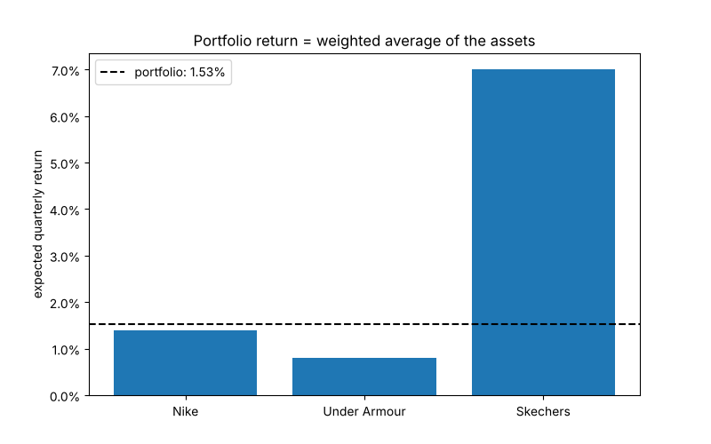
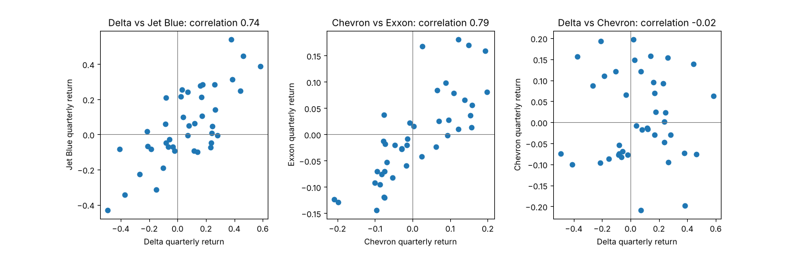
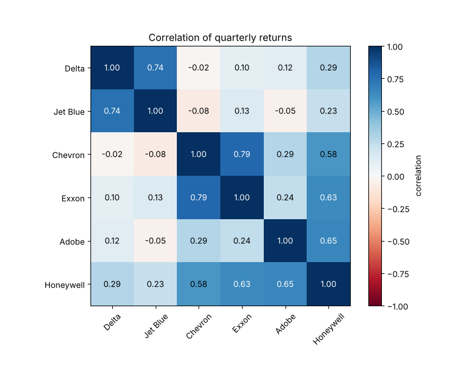
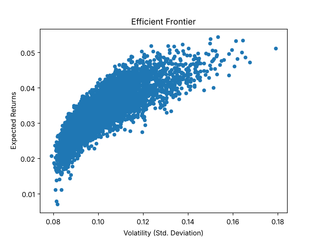
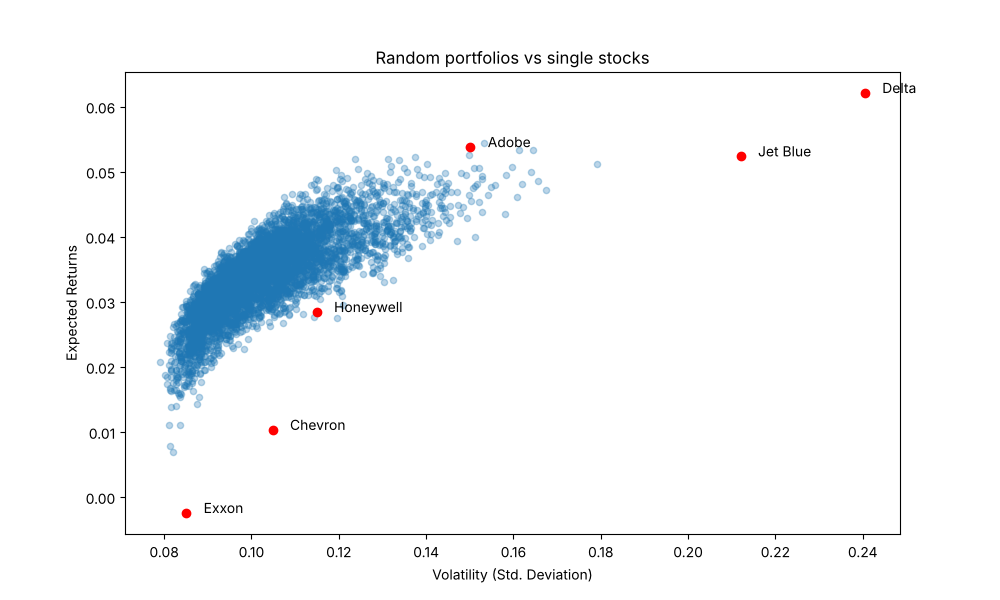
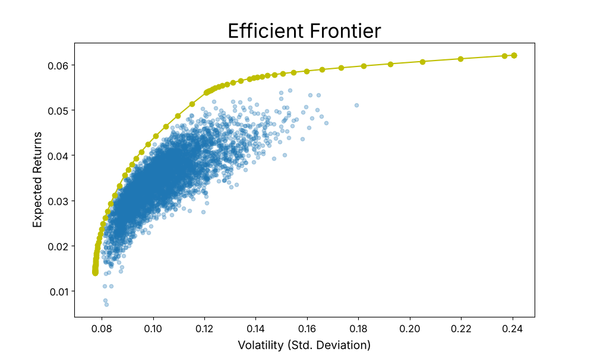

# 5 - Mean-Variance Optimization: chart gallery

Every chart in this folder is produced by the notebooks next to this page and saved to `charts/`.
Open [01_mean_variance_optimization.ipynb](01_mean_variance_optimization.ipynb) to see each chart directly under the code that made it.

## 01 - Mean-Variance Portfolio Optimization

| | |
|---|---|
| **Average vs compound return** - the average rewards volatile stocks  | **Growth of 1 EUR** - `stock_data / stock_data.iloc[0]`  |
| **Portfolio weights** - `amounts / amounts.sum()`  | **Portfolio return** - weighted average, `weights @ returns`  |

**Covariance in pairs** - airlines together, oil together, airline vs oil about 0

**Correlation heatmap** - `plt.imshow(returns_corr, cmap='RdBu')`: airlines and oil as two blocks

| | |
|---|---|
| **5,000 random portfolios** - `df.plot.scatter(x='Volatility', y='Returns')`  | **Portfolios vs single stocks** - mixing beats most single stocks  |

**Efficient frontier** - `optimal_portfolio()`, yellow line on the top-left edge

