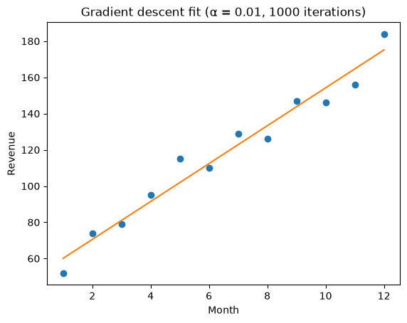

# 6 - Linear Regression: chart gallery

Every chart in this folder is produced by the notebooks next to this page and saved to `charts/`.
Open [01_the_model.ipynb](01_the_model.ipynb) to see each chart directly under the code that made it.
Key words for the whole track: [00_key_words.md](00_key_words.md).

## 01 - The Model

| |
|---|
| **Gradient descent fit** - `gradient_descent(months, revenue, 0.01, 1000)` → b ≈ 49.6, m ≈ 10.5  |
