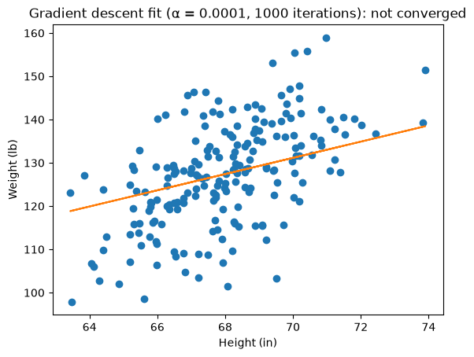
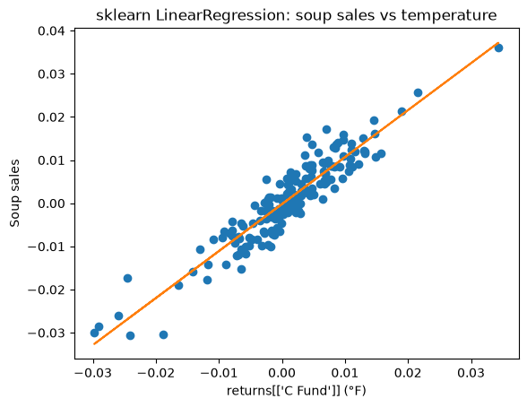
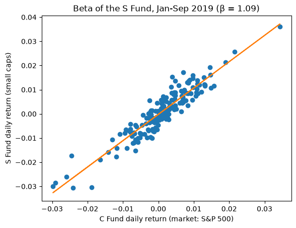

# 6 - Linear Regression: chart gallery

Every chart in this folder is produced by the notebooks next to this page and saved to `charts/`.
Open [01_the_model.ipynb](01_the_model.ipynb) to see each chart directly under the code that made it.
Key words for the whole track: [00_key_words.md](00_key_words.md).

## 01 - The Model

| |
|---|
| **Gradient descent fit** - `gradient_descent(months, revenue, 0.01, 1000)` → b ≈ 49.6, m ≈ 10.5  |
| **Real data: height vs weight** - α = 0.0001 looks fine but hasn't converged (b ≈ 0 vs OLS −106)  |
| **sklearn `LinearRegression`** - soup sales vs temperature (m ≈ −1.15)  |

### Project: beta of the S Fund (CAPM regression)

[01_project_beta_capm.ipynb](01_project_beta_capm.ipynb): daily returns of US small caps (TSP S Fund) regressed on the S&P 500 (C Fund), Jan–Sep 2019, with sklearn `LinearRegression`. β ≈ 1.09, α ≈ −0.02%/day, R² ≈ 0.87.

| |
|---|
| **Beta of the S Fund** - slope of the fitted line = β  |
